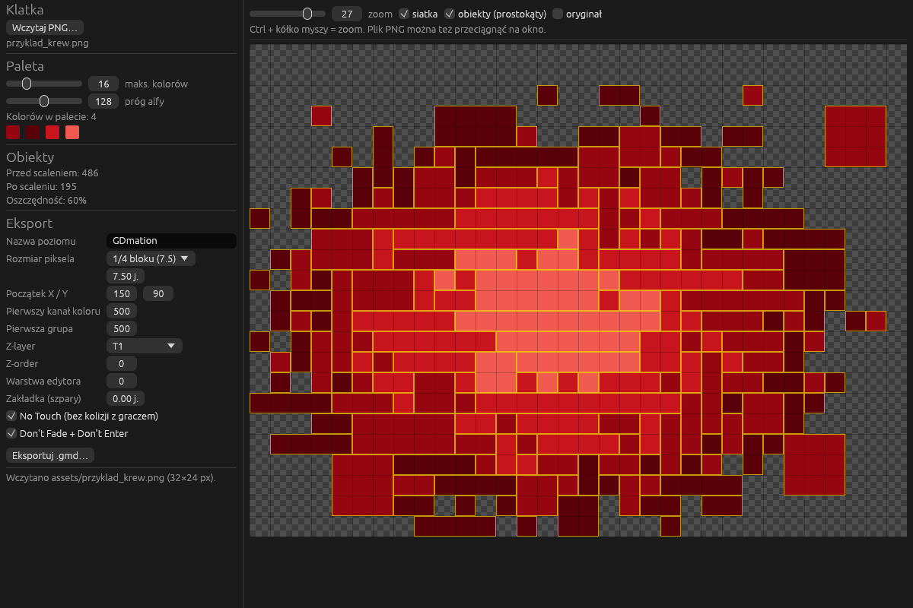

# GDmation

Narzędzie desktopowe (Windows) do zamiany klatek pixel-art PNG na obiekty **Geometry Dash 2.209**.
Działa obok gry: bez modów, bez Geode, bez zmiany wersji gry. Program tworzy **osobny poziom** z gotowym
obrazem. Obiekty z niego kopiujesz w edytorze do swojego właściwego poziomu.



## Status

| Etap | Zakres | Stan |
|---|---|---|
| 1 (MVP) | 1 klatka PNG, podgląd z siatką i zoomem, redukcja palety, scalanie bloków, eksport `.gmd` | **gotowe, czeka na test w grze** |
| 2 | wiele klatek, grupa na klatkę, automatyczny Z-order/Z-layer | planowane |
| 3 | triggery Toggle/Alpha + Spawn, tempo klatek, pętla / jednorazowo | planowane |
| 4 | zapis do `CCLocalLevels.dat` (z kopią zapasową), projekty JSON (prefaby) | planowane |

Zakresy ID grup i kanałów (funkcja 6) są już konfigurowalne.

## Budowanie

### Gotowy `.exe` z GitHub Actions
Każdy push uruchamia workflow `build` (`.github/workflows/build.yml`) na `windows-latest`:
testy, clippy, build release i testowy eksport. W zakładce **Actions** → ostatni przebieg → artefakt
**gdmation-windows** (zawiera `gdmation.exe` i przykładowy `przyklad_krew.gmd`).

### Lokalnie na Windows
1. Zainstaluj Rust: <https://rustup.rs> (toolchain `stable-x86_64-pc-windows-msvc`; instalator
   poprosi o *Visual Studio Build Tools* z komponentem „C++ build tools”: potrzebny jest linker
   i kompilator C, bo gdlib kompiluje zlib).
2. W katalogu projektu:
   ```
   cargo build --release
   ```
3. Plik wynikowy: `target\release\gdmation.exe`. CRT jest linkowany statycznie
   (`.cargo/config.toml`), więc `.exe` nie wymaga instalowania Visual C++ Redistributable.

Testy: `cargo test`. Wersja bez GUI (np. do skryptów):
```
cargo run --release --example png2gmd -- klatka.png wynik.gmd 16
```

## Jak używać

1. **Wczytaj PNG…** (albo przeciągnij plik na okno lub na `gdmation.exe`).
   Przezroczyste piksele (alfa poniżej progu) nie tworzą obiektów.
2. **Paleta**: ustaw maksymalną liczbę kolorów. Gdy obraz ma ich mniej, kolory zostają dokładnie takie
   same; gdy więcej, program redukuje je algorytmem *median cut*. Każdy kolor palety = jeden kanał
   koloru w GD (najedź na próbkę, żeby zobaczyć numer kanału).
3. **Obiekty**: licznik „przed scaleniem” (1 piksel = 1 obiekt) i „po scaleniu” (greedy meshing).
   Na podglądzie włącz „obiekty (prostokąty)”, żeby zobaczyć, jak piksele zostały połączone.
4. **Eksport**:
   - *Rozmiar piksela*: ile jednostek GD ma jeden piksel PNG (30 = pełny blok edytora,
     7.5 = 1/4 bloku). Skala obiektu jest liczona dokładnie, bez ręcznego skalowania w edytorze.
   - *Początek X / Y*: lewy dolny róg obrazu w jednostkach GD (wielokrotność 30 = róg kratki).
   - *Pierwszy kanał koloru* / *Pierwsza grupa*: początek zakresów, żeby nie kolidowały z tym, co
     już masz w poziomie. Kanały: `start … start + liczba_kolorów − 1`, grupy: `start … start + klatki − 1`.
   - *Z-layer*, *Z-order*, *Warstwa edytora*: wspólne dla wszystkich obiektów klatki.
   - *Zakładka (szpary)*: dodaje kilka setnych jednostki do każdego obiektu, gdyby między blokami
     pojawiały się cienkie szpary (domyślnie 0).
   - *No Touch*: obiekty nie kolidują z graczem (blok 211 jest normalnie bryłą!).
   - *Don't Fade + Don't Enter*: piksele ignorują efekty wejścia, więc obraz nie rozsypie się
     przy wjeździe kamery.
5. **Eksportuj .gmd…** zapisuje osobny poziom.

## Import do gry

Główna droga: wyeksportuj `.gmd` i zaimportuj go w grze (2.209 ma import poziomów z pliku).
Wynik pojawi się jako nowy poziom lokalny o nazwie ustawionej w programie.

<!-- TODO: dokładna ścieżka w menu gry, po potwierdzeniu przez autora poziomu. -->

Zapis bezpośrednio do `%LOCALAPPDATA%\GeometryDash\CCLocalLevels.dat` (etap 4) jest opcjonalny,
z obowiązkową kopią zapasową i ostrzeżeniem, że gra musi być zamknięta.

## Kopiowanie animacji do innego poziomu

1. Otwórz wygenerowany poziom w edytorze.
2. Zaznacz wszystko (np. przeciągnięciem w trybie Edit, albo *Select All* z menu edytora).
3. **Copy**, wyjdź, otwórz swój poziom, **Paste** w wybranym miejscu.
4. **Kanały kolorów nie kopiują się razem z obiektami.** Obiekty odwołują się do kanałów
   (np. 500–503), ale ich kolory są zapisane w ustawieniach poziomu. W docelowym poziomie ustaw te
   same kanały na te same kolory (wartości RGB widać po najechaniu na próbki palety w programie).
   Dlatego warto dobrać *Pierwszy kanał koloru* tak, żeby nie nachodził na kanały już używane.
5. Grupy (500…) są zapisane w obiektach, więc kopiują się razem z nimi.

## Skąd pochodzą wartości

Nic nie jest wpisane z pamięci. Źródła: kod gdlib 0.4.3 (crates.io, repozytorium
`ArrowSlashArrow/gdlib`; jego tabele bazują na dokumentacji wymienionej w README gdlib: gddocs
Wyliemastera, gmdkit, gd-info-explorer Flowvixa, boomlings.dev) oraz pomiary na poziomach
testowych dołączonych do gdlib.

| Wartość | Znaczenie | Źródło |
|---|---|---|
| obiekt `211` | „Colored Inner Square”, blok pikseli | `gdlib::cclocallevels::gdobj::ids::objects::COLORED_INNER_SQUARE` (generowane z `properties.rs`, `OBJECT_NAMES`) |
| `1` | ID obiektu | gdlib `GDObject::serialise_to_string` |
| `2`, `3` | pozycja X, Y = **środek** obiektu | gdlib `GDObjConfig::serialise_to_string`; pomiar: w `Chompstep.gmd` i `big.gmd` nieskalowane bloki mają pozycje ≡ 15 (mod 30) |
| 30 jednostek | rozmiar bloku przy skali 1.0 | pomiar jak wyżej (siatka 30, środek w połowie) |
| `128`, `129` | skala X, Y | gdlib `PROPERTY_TABLE` („X scale”, „Y scale”) |
| `21` | kanał koloru głównego | gdlib `ids::properties::OBJECT_COLOUR` |
| `24` | Z-layer: B5=−5, B4=−3, B3=−1, B2=1, B1=3, T1=5, T2=7, T3=9, T4=11 | gdlib `structs::ZLayer` |
| `25` | Z-order | gdlib `ids::properties::Z_ORDER` |
| `20` | warstwa edytora 1 | gdlib `PROPERTY_TABLE` („Editor layer 1”) |
| `57` | grupy (lista z kropką) | gdlib `PROPERTY_TABLE` („Groups”) |
| `64`, `67` | Don't Fade, Don't Enter | gdlib `ids::properties::DONT_FADE`, `DONT_ENTER` |
| `121` | No Touch | gdlib `ids::properties::NO_TOUCH` |
| kanały 1–999 | zwykłe kanały koloru; ≥1000 to specjalne (1000 BG, 1001 G1, 1004 Obj…) | gdlib `structs::ColourChannel` (dokumentacja + `From<i16>`) |
| grupy 1–9999 | zakres grup | gdlib `GDLevelData::get_unused_groups` |
| `kS38` | lista kanałów kolorów w nagłówku poziomu; wpis: `1/2/3` RGB, `6` kanał, `7` krycie, `4` kolor gracza (−1 = brak) itd. | gdlib `leveldata::ColourString` (odnośnik do boomlings.dev „color-string”), format wpisów skopiowany z `DEFAULT_LEVEL_HEADERS` |
| `k50` = 49 | binaryVersion dla 2.209 | gdlib `GDVersion::GD2209.to_binary_version_id()` |
| `k17` = 22 | gameVersion dla 2.2xx | gdlib `GDVersion::to_game_version_id()` |

Do etapu 3 (sprawdzone w gdlib, jeszcze nieużywane): Alpha `1007`, Toggle `1049`, Spawn `1268`;
właściwości: `51` cel (grupa), `56` aktywuj grupę, `35` krycie, `10` czas, `63` opóźnienie spawnu,
`62` Spawn Triggered, `87` Multi Trigger.

## Znane ograniczenia

- Brak wiarygodnego testu w samej grze: autor narzędzia nie ma dostępu do GD. Sprawdzone jest tylko to,
  co da się sprawdzić automatycznie (testy jednostkowe, round-trip `.gmd` przez gdlib).
- gdlib 0.4.3 **odczytuje** flagi zapisane jako `1` (np. No Touch) jako `false`, bo parsuje je przez
  `str::parse::<bool>()`. Zapis jest poprawny (`121,1`), test round-trip sprawdza flagi w surowym
  stringu poziomu.
- gdlib pomija klucz `24` przy warstwie T1 (uważa ją za domyślną); GDmation dopisuje go jawnie.
- W gdlib 0.4.3 `GDObjConfig::set_attributes` i `set_groups` biorą `self` przez wartość i niczego nie
  zmieniają; GDmation używa wariantów `with_*`.
- Maksymalnie 255 kolorów w palecie (w GUI suwak do 64).
- Półprzezroczyste piksele: albo w pełni widoczne, albo pominięte (próg alfy).

## Do sprawdzenia w grze (po pierwszych testach)

Na przykładowym `assets/przyklad_krew.png` (lub własnej klatce):

1. Czy gra przyjmuje plik `.gmd` z GDmation przy imporcie, a poziom otwiera się w edytorze
   bez błędu i ma nazwę ustawioną w programie. Jeśli import odrzuci plik, prześlij mi komunikat
   (gdlib zapisuje `.gmd` w kompaktowym formacie plist `gjver="2.0"`).
2. Czy obiekt 211 to pełny kwadrat bez obramowania i bez cieniowania.
3. Czy obraz nie jest odwrócony (góra PNG = góra w grze) i czy proporcje się zgadzają.
4. Czy przy rozmiarze piksela 7.5 obraz 32×24 zajmuje 8×6 kratek, a lewy dolny róg leży w (150, 90),
   czyli na rogu kratki.
5. Czy między sąsiednimi prostokątami nie ma szpar ani nakładek (zoom w edytorze i w grze).
   Jeśli są szpary, przetestuj *Zakładka* = 0.05.
6. Czy kolory się zgadzają: w *Edit Level → Color* kanały 500…503 mają kolory z palety.
7. Czy obiekty mają grupę 500, Z-layer T1, No Touch, Don't Fade, Don't Enter (okno *Edit Object*,
   *Edit Group*).
8. Czy gracz przechodzi przez obraz (No Touch) i nie ginie.
9. Czy po skopiowaniu do innego poziomu obiekty zachowują grupę, a po ustawieniu kanałów kolory
   wyglądają tak samo.
10. Czy duże skale (np. prostokąt 32×1 piksela przy 30 j./px) wyświetlają się poprawnie.
